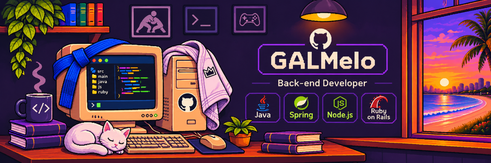

  

<h2 align="center">Olá, eu sou o Gabriel! 👋</h2>

  Desenvolvedor Back-end • Formado em Sistemas de Informação pelo IFAL

Sou desenvolvedor back-end, apaixonado por tecnologia e por construir soluções que fazem a diferença.  No dia a dia, trabalho com desenvolvimento de APIs e aplicações, sempre buscando aprender e evoluir.
  
Fora do código, gosto de jogos e jiu-jitsu. 🎮 🥋
🛠️ Tecnologias

  

📫 Contato

  
  
  

